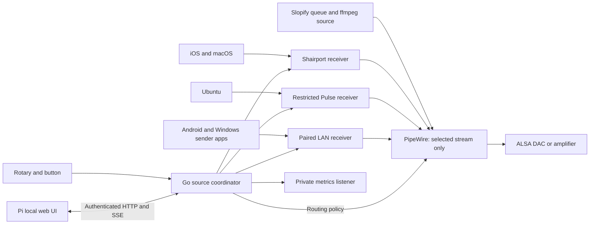

# Local network audio sources and device control

Status: proposed design, 28 October 2026. This does not enable network receivers,
change device networking, or define a custom OS image.

> **Superseded in part, 30 October 2026.** The PipeWire engine, WirePlumber policy, patches
> and native Go PipeWire client described here were built, then removed. The player now
> writes directly to ALSA and has its own Pulse receiver; see `AGENTS.md` and `README.md`.
> Sections about PipeWire are kept as a record of the reasoning and the test results.

## Device-player project goals

1. **Lossless, native-rate playback of Slopify originals.** Preserve the decoded
   source sample rate and integer precision through the physical output. Do not
   resample originals, apply software gain, or route full-S32 PCM through float32.
   Lossless 16/24-to-32 word packing and mono duplication are allowed. Unsupported
   hardware formats/rates must produce a visible error, not silent conversion.
   Use hardware volume when explicitly enabled; leave it untouched by default.
2. **Audio streaming from laptops over the local network.** Accept desktop audio
   through appropriate receiver adapters, identify its sender and make routing,
   activity, format and conversion visible. Laptop mixing can already have changed
   rate/precision before transmission. Do not claim original-file bit transparency
   for a desktop mix; expose further receiver conversion instead of hiding it.

Selection, pinning, receiver authentication and observability support these two
primary goals. AirPlay and further adapters are extensions. DLNA renderer implementation is
deferred; ESound is out of
scope. Protocol breadth must not compromise the Slopify-original playback path.

The original-playback acceptance check is end-to-end: compare decoded PCM with
the samples delivered to the output, allowing only the lossless packing above,
and verify the hardware runs at the source sample rate. A successful build or
integer format reported by PipeWire alone does not establish this guarantee.
For laptop streaming, verify connection, sender identity, audible playback and
return to Slopify after the laptop stops or disconnects.

## Proposed device role

A Slopify speaker should accept its account queue and selected audio from nearby
phones and computers. A Go coordinator on the speaker chooses one source,
handles pinning and volume, and serves local administration and metrics. Protocol
adapters receive network audio; PipeWire is the preferred audio engine and sole
physical output owner. Go remains the source-selection policy authority.
Use multicast for discovery and unicast for audio initially. Existing Slopify
cloud connections remain outbound authenticated HTTPS.

The first receiver target is the Ethernet-connected Pi with a HiFiBerry board.
A phone on Wi-Fi and a speaker on Ethernet can share the same LAN. This is audio
reception from iOS, macOS, Ubuntu, Android and possibly Windows, not a proposal
for running the Linux player binary on those operating systems.

## Current implementation and proposed boundaries

Today `player/` follows one Slopify output over HTTPS/SSE, launches ffmpeg to
decode originals, and uses aplay for ALSA output. Opt-in hardware volume uses
amixer; the rotary handler and asynchronous volume reporter run separately.
An experimental `pipewire:<node>` output now feeds raw PCM through pw-cat, with
client resampling/channel mixing disabled and estimated latency. It has not
passed the strict graph/precision gates below. A Pi-only trusted-LAN Pulse receiver experiment is now configured separately
under `deploy/raspi/pipewire`, with anonymous access explicitly requested for
that network. An opt-in `-pipewire-volume` bridge maps TCP playback-stream
volume to the configured hardware range and normalizes stream soft gain; it
reflects knob/web changes and keeps mute per-stream. This prototype does not
implement source arbitration or the production admission model below.
The opt-in `-local-listen` page now provides read-only local status/SSE and
Ubuntu setup instructions. It is a trusted-LAN prototype without admin login
or mutations. There are no AirPlay, Android or Windows receivers, no local
source arbiter or authenticated device administration. Optional native sample
counters and a Prometheus-backed local activity view are now implemented as
experiments. Local protocol inventory stays on the device; cloud reporting of external
source availability is deferred.

Keep the existing catalog, players service, authorization and account queue.
Introduce device-side components without giving protocol receivers access to
cloud tokens, media-signing keys, the library tree or account queues.

| Component | Responsibility | Access |
|---|---|---|
| Go coordinator | Source registry, authentication decisions, arbitration, pinning, local API/SSE and metrics | Device configuration and local control socket |
| PipeWire engine | Stream buffering, format negotiation, graph routing and sole DAC ownership | ALSA PCM device; protected local client sockets |
| Device hardware controls | Rotary events, board mixer/dB mapping, boot level and volume cap | Restricted input and mixer access; independent of selected source |
| Slopify source | Existing authenticated queue following, original fetch and ffmpeg decode | Its device token, outbound Slopify HTTPS, assigned PCM socket |
| AirPlay adapter | Shairport Sync, session metadata and PipeWire playback stream | LAN AirPlay ports and restricted local engine/control sockets; no physical sound device |
| Ubuntu adapter | Restricted Pulse-compatible receiver admitting individual streams where available | Its LAN endpoint and restricted engine/control sockets |
| Paired LAN receiver | HTTPS sessions for prospective Android/Windows senders | Device-specific paired client credentials and assigned local sockets |
| Discovery service | Publish enabled receiver/UI endpoints on configured LAN interfaces | mDNS; no device administration credentials |

Keep the Go controller and native audio services as separate components initially.
Do not rewrite the player in C/C++ or embed entire sound servers to use their
routing. A small native client/helper is an option if needed by the PipeWire
API; linking libpulse/libpipewire provides client APIs, not embedded servers.
Shairport is an application rather than a drop-in receiver library. Reusing it
avoids reimplementing pairing, cryptography, packet recovery and clock sync.
No CGO dependency is proposed for cloud services.

Keep control and audio queues separate. Audio callbacks, rotary actuation and
hardware writes never wait for HTTP, discovery or Prometheus scrapes. A restricted
WirePlumber policy or explicit controller-managed links must prevent competing
automatic routing; the default desktop policy is not the appliance policy.



## Source platforms

The supported OS list is a client compatibility matrix, not one interchangeable
wire protocol. Each receiver advertises only features actually enabled and
verified in the selected build.

| Source OS | Initial path | Client experience and limitations |
|---|---|---|
| iOS and iPadOS | AirPlay to Shairport Sync | Select the speaker in the app or Control Center; no Slopify capture app required. Test actual apps, protocol mode and sender remote-control behavior. |
| macOS | AirPlay to the same receiver | Select output in Sound/Control Center or an application's AirPlay menu. A whole-system route can also carry notification sounds. A future native sender can select particular applications. |
| Ubuntu with PulseAudio | Authenticated Pulse native connection/tunnel to an isolated receiver endpoint | Make the speaker available as a desktop output; pairing/setup may be required before it appears. Model clients separately where the protocol exposes them. |
| Ubuntu with PipeWire | Pulse-compatible path first | Use pipewire-pulse and a compatible sender/tunnel configuration; automatic network sink discovery must be tested on supported Ubuntu releases. Native PipeWire networking is optional later. |
| Android | Paired sender app using playback capture; own-media streaming separately | User-granted capture, supported apps only. No claim of universal phone/system-audio casting. |
| Windows | Paired sender using WASAPI capture; evaluate later | Endpoint loopback for system audio or supported application capture. A background agent is not automatically a selectable Windows sound device. |

Apple documents AirPlay sending from both iPhone/iPad and Mac. macOS offers a
system output route as well as app routes; the iOS UI and individual app behavior
are different. Do not infer identical notification handling or remote play/pause
from using the same receiver. [Apple AirPlay audio](https://support.apple.com/en-us/105068)

Shairport Sync supports audio reception, pipe/stdout and sound-server outputs,
metadata and some remote controls. Build features and sender behavior vary;
there is no AirPlay video requirement. Its pipe output does not preserve the
same end-to-end timing feedback as direct hardware output. [Shairport Sync](https://github.com/mikebrady/shairport-sync)

PipeWire provides a PulseAudio-compatible server, but that alone does not install
or configure a desktop network-output tunnel. PulseAudio documents separate
native TCP, authorization and Zeroconf setup. [pipewire-pulse](https://pipewire.pages.freedesktop.org/pipewire/page_man_pipewire-pulse_1.html),
[PulseAudio network setup](https://wiki.freedesktop.org/www/Software/PulseAudio/Documentation/User/Network/)

### AirPlay codecs and implementation cost

File codec, AirPlay wire codec, decoded representation and DAC format are
separate facts. An iPhone playing a lossless file does not establish a lossless
AirPlay session. Report negotiated codec/mode rather than infer it from an
Apple Music quality badge. Shairport 5.6 documents these stereo paths:

| Mode | Wire codec | Documented decoded description |
|---|---|---|
| Realtime | ALAC | 16-bit, 44.1 kHz |
| Buffered | AAC | F24 description, 44.1 or 48 kHz; lossy |
| Buffered lossless | ALAC | 24-bit, 48 kHz; depends on sender/path |

F24 does not prove a 24-bit lossless original. Do not promise that every iOS app
selects the buffered lossless path, a fixed AAC bitrate, or 96/192 kHz AirPlay.
The receiver also supports surround paths, outside the initial mono/stereo
scope. AirPlay 2 requires NQPTP timing and native codec libraries; retaining a
Go controller does not make the whole appliance free of native dependencies.
[Shairport AirPlay 2 formats and dependencies](https://github.com/mikebrady/shairport-sync/blob/master/AIRPLAY2.md)

A Go rewrite must still implement protocol sessions, authentication/crypto,
packet recovery, timing, clock drift, flush/seek, metadata and interoperability.
This is substantially larger than an ALSA output backend or a narrow Pulse
receiver. Existing Go work such as goplay2 is a reference to evaluate, not an
assumed replacement: its README lists limited codec/features and native audio
and AAC dependencies. Rewriting the complete player in C/C++ does not remove
these protocol requirements. Prefer maintained receiver components and a small
integration surface. [goplay2 scope](https://github.com/openairplay/goplay2)

### Ubuntu protocols, control and compression

Pulse native TCP carries audio and stream-control messages, commonly on port
4713. PipeWire's Pulse compatibility allows the same client protocol. Native
PipeWire IPC instead uses local Unix sockets and is not an interchangeable LAN
TCP protocol. RTP over UDP is a separate transport option, not what a Pulse TCP
tunnel uses. mDNS discovery is separate from all of these media transports.
[Native PipeWire protocol](https://docs.pipewire.org/page_module_protocol_native.html),
[Pulse protocol versions](https://github.com/pulseaudio/pulseaudio/blob/master/PROTOCOL)

Pulse control includes stream creation, format/buffering, timing, cork, flush,
drain, volume, properties and subscriptions. Application-supplied properties
such as application.name, media.name, media.title, media.artist and media.role
may provide useful labels and notification hints; they are optional and cannot
serve as trusted identity. Corking a stream is not a generic remote next-track
command. A system-output tunnel may lose per-app distinctions. Existing Go
Pulse clients and protocol packages are not ready-made receiver servers.
[Pulse properties](https://www.freedesktop.org/software/pulseaudio/doxygen/proplist_8h.html)

A narrow Go receiver would still need bounded framing/version negotiation,
auth, sink introspection, playback creation, flow control/timing, control events
and safe rejection of capture/module/admin operations. Planning estimate only:
roughly 2,500–4,600 production lines plus 1,500–3,000 test lines for a constrained
TCP receiver, excluding dependencies, mixing/resampling and broad compatibility.
The preferred PipeWire receiver avoids that implementation initially.

Ordinary native Pulse TCP uses uncompressed PCM; do not promise transparent
FLAC/Opus compression. Stereo PCM payload rates are 1.4112 Mbit/s at 44.1 kHz
16-bit, 2.304 Mbit/s at 48 kHz packed 24-bit, and 12.288 Mbit/s at 192 kHz
32-bit. Framing adds overhead. Opus can be an explicit lossy option on another
transport/custom sender; FLAC is lossless with variable bandwidth. Neither
silently changes the strict Slopify path.
[Pulse network transport](https://www.freedesktop.org/wiki/Software/PulseAudio/Documentation/User/Network/)

### Ubuntu sender setup and authentication experiment

These are proposed manual interoperability steps for Ubuntu 24.04/26.04, not
commands already applied to the Pi. The current player does not offer a Pulse
receiver. Identify the desktop server with `pactl info`; install client tools
with `sudo apt install pulseaudio-utils` if absent. Do not replace the desktop's
PipeWire daemon or install a competing receiver daemon as an incidental step.

For an isolated **real PulseAudio** test receiver, create a private 256-byte
cookie once, retain it across restarts, and configure module-native-protocol-tcp
with the cookie enabled, anonymous access disabled, and an explicit listen
address. Transfer the cookie over SSH to the desktop, storing it with directory
mode 0700 and file mode 0600. Do not add auth-ip-acl expecting a second required
factor: IP-based authorization can admit a client independently of its cookie.
Use firewall restrictions separately. Cookie sharing identifies an admission
group; revoking one member requires rotating the shared cookie. This recipe
must not be assumed to configure pipewire-pulse authentication identically.
[Pulse receiver authentication](https://www.freedesktop.org/wiki/Software/PulseAudio/Documentation/User/Modules/)

With that receiver configured, load a temporary desktop output as the logged-in
user, without sudo. The documentation-only address below must be replaced:

```sh
pactl load-module module-tunnel-sink \
  server=tcp:192.0.2.199:4713 sink_name=slopify \
  cookie="$HOME/.config/slopify/pulse.cookie"
pactl set-default-sink slopify
```

Record the returned module ID for `pactl unload-module ID`. Selecting the new
default does not guarantee existing application streams move; select their
output in sound controls/pavucontrol. Test disconnect and recovery before
persisting the module. For a PipeWire desktop, a user drop-in at
`~/.config/pipewire/pipewire-pulse.conf.d/30-slopify.conf` can load it on startup:

```ini
pulse.cmd = [
  { cmd = "load-module"
    args = "module-tunnel-sink server=tcp:192.0.2.199:4713 sink_name=slopify cookie=/home/YOURUSER/.config/slopify/pulse.cookie"
  }
]
```

Use the real absolute cookie path; do not rely on shell variable expansion in
the configuration file. Restarting the user pipewire-pulse service interrupts
audio. Avoid duplicate temporary/persistent modules and validate options on the
installed release. [PipeWire tunnel options](https://docs.pipewire.org/page_pulse_module_tunnel_sink.html)

Pulse native TCP is not a confidentiality boundary. For an encrypted test,
bind the receiver to loopback and forward it over SSH:

```sh
ssh -N -L 127.0.0.1:14713:127.0.0.1:4713 receiver-user@192.0.2.199
```

Point the desktop module at `tcp:127.0.0.1:14713` and retain cookie authentication.
No discovery is needed for manual addressing. Production must establish the
actual PipeWire receiver's admission and graph permissions before opening LAN
access; the classic Pulse test recipe is not that security design.

### Android support

Android 10 introduced AudioPlaybackCapture. A sender needs RECORD_AUDIO and
user-approved MediaProjection, must share the playing app's user profile, and
can capture only audio permitted by the app and its usage/capture policy.
Supported usages include media, games and unknown; this is not unrestricted
notification/call capture. Select eligible applications where possible and stop
when permission is revoked. [Android playback capture](https://developer.android.com/media/platform/av-capture)

Respect projection-session consent, foreground-service requirements and stop
callbacks for the target Android version. Do not save a consent token as a
permanent capture permission or promise silent unattended restarts.
[Android media projection](https://developer.android.com/media/grow/media-projection)

AudioRelay demonstrates app-based Android-to-computer audio with the same
capture restrictions. Evaluate it as an optional interoperability experiment,
not an assumed open protocol, supported ARM headless receiver or bundled
component. [AudioRelay phone source documentation](https://docs.audiorelay.net/instructions/stream-audio-from-a-phone-to-a-pc-or-to-another-phone)

A normal Linux container does not become a Google Cast receiver merely by
advertising mDNS. Google's Web Receiver SDK runs receiver applications on
Cast-enabled devices; native Cast support is a separate feasibility decision.
[Cast Web Receiver overview](https://developers.google.com/cast/docs/web_receiver)

### Windows and optional macOS senders

A Windows sender may capture the shared endpoint mix through WASAPI loopback.
Supported application-loopback APIs permit narrower capture on compatible
versions. Prefer an explicit application allowlist over capturing every system
sound; protected streams may remain unavailable. A true Windows output device
requires separate virtual-device/driver work and is outside the first sender.
[WASAPI loopback](https://learn.microsoft.com/windows/win32/coreaudio/loopback-recording),
[Microsoft application loopback sample](https://github.com/microsoft/Windows-classic-samples/blob/main/Samples/ApplicationLoopback/README.md)

A prospective macOS sender can use supported ScreenCaptureKit audio filtering
with OS permission. This is separate from AirPlay and does not establish the
same capture permissions or background behavior on iOS; define and test an OS
support floor before implementation. Do not introduce Electron
or a desktop framework just to capture audio.
[Apple macOS capture sample](https://developer.apple.com/documentation/screencapturekit/capturing-screen-content-in-macos)

## Audio ownership and format policy

Exactly one engine can write the physical DAC. Protocol adapters do not receive
`/dev/snd` mounts. Source pinning must be enforced by the engine's lease checks,
not just by an adapter politely observing hooks or a UI hiding its play button.
Mute is independent of source selection and never clears a pin.

Prefer the distribution PipeWire engine before building a custom Go audio engine.
Ubuntu 26.04 packages PipeWire 1.6.2 for ARM64, a suitable baseline for this
prototype; availability does not imply it is installed on Ubuntu Server or
that the Pi's configuration has been tested. No custom PipeWire build is
currently required. [Ubuntu ARM64 packages](https://packages.ubuntu.com/search?arch=arm64&keywords=pipewire&suite=resolute)

Retain ffmpeg decoding in the Go Slopify source. Keep direct ALSA as an existing
fallback while validating the new backend. gen2brain/alsa remains an option for
native hardware mixer access or a direct backend, not the preferred replacement
for PipeWire's graph. Validate TLV/dB mapping and board behavior before replacing
amixer. Hardware control must not silently become software attenuation.
[Go ALSA API](https://pkg.go.dev/github.com/gen2brain/alsa)

The PCM contract names sample rate, channels, integer/float representation,
valid bits and container bits separately. A 24-bit sample in a 32-bit word is
still 24-bit audio. Report received codec precision only when known; a 32-bit
float desktop mix does not establish the original recording's bit depth.

### Playback backend separation

The Go controller now owns queue reconciliation and recovery through backend and
session interfaces. The existing PCM engine remains the default, preserving
ffmpeg decoding, prefetch and independently usable ALSA output. Hardware volume,
native mute and rotary controls do not belong to either playback engine.

An experimental Linux mpv engine consolidates decoding, buffering and output
into one persistent subprocess. Go uses JSON IPC over an inherited socket, not
an exposed command listener. Native ALSA and PipeWire outputs are explicit;
fallback to another output or a silent null device is disabled. S32 is requested
with unity gain and no ReplayGain/user scripts; differing source/output rates or
lossy channel changes fail validation at playback restart. Weak gapless mode
allows reopening the output for a format change. The upcoming URL is obtained
near the boundary and only one successor is retained.

Local null-output tests cover consecutive tracks, sample-rate transitions,
seeked sessions, pause/resume without restarting mpv and recovery after process
death without falsely reporting EOF. A file-output experiment preserved S32 low
bits and added trailing zero padding; it does not establish DAC bit transparency
or exact gapless sample counts. Native managed source admission, full S32 on the
Pi, same-format network transitions and rate changes remain release gates. The
former PCM engine and Compose stack were removed; mpv is the only engine and the
Pi installs under systemd (`player/deploy`). Live amplifier verification is still required.
The Pi systemd trial now enables native Go peak capture. The diagnostic
`-disable-local-metering` flag remains available to isolate observation from
playback; manual pinning still works with it enabled. Long-run amplifier and
underrun verification remain separate from the isolated capture tests below.
[mpv IPC and audio options](https://mpv.io/manual/stable/)

### Native Go PipeWire control and capture trial

`internal/pipewire` now supplies the player with native Unix-socket graph
observation, source-target metadata writes and stream-volume parameter updates.
These replace `pw-dump`, `pw-metadata` and `pw-cli` in the local controller and
volume bridge. Playback uses mpv; direct ALSA does
not open this connection. The Go executable remains static, without CGo.

The protocol implementation bounds messages to 1 MiB, active proxy bindings to
512, pending sync requests to 32 and queued graph events to 512. It queues SCM_RIGHTS
descriptors independently of byte framing: PipeWire can batch descriptors for later
messages into an earlier socket read. Control writes have a two-second deadline;
failed connections are discarded and observers reconnect. UI properties still pass
through the existing allowlist. Server error text is not copied into player logs.

On Linux amd64/arm64, the player reads the `audio.peaks.v1` POD from
native node Props. Patch 10 measures already-produced PCM in the converter when
`audio.stats=true`. It never writes PCM, creates a processing branch, retains a
playback buffer or waits for a reader. Each node owns a fixed 32-slot ring of
peak/sequence/frame-shape/monotonic-time snapshots. Lock-free 32-bit atomic words
and bounded single-attempt snapshot reads avoid reader/writer blocking. Slow
readers lose old windows; unknown formats and oversized blocks produce no sample.
Only the peak scalar is converted to float, not the playback samples.

The control loop publishes cached client-node Props every 200 ms. Go uses its
existing native control protocol to subscribe/poll, drops stale windows and
aggregates fresh peaks for SSE and existing Prometheus histograms. There is no
shared-memory PCM reader or `resample.peaks` converter in production metering.
Those experimental capture helpers remain only for regression probes. Stale
rings on paused nodes do not manufacture fresh sound after a reconnect.

Unselected managed sources use separate native-rate null destinations, created
and owned by the local controller, so receiver consumption does not depend on a
meter. These destinations never link to the amplifier and are excluded from the
UI/output exporter inventory. The selected source uses the normal hardware
route. Receiver lifecycle is independent of whether observations are enabled.

The stopped-reader gate uses independent pw-cat playback/recording, numbered S32
frames and SIGSTOP of the observer process for three seconds. On the ARM64 1.6.2
build with patch 10 it passes in one private graph through 44.1→48→96→44.1 kHz,
including normal observation, stopped reader, resumed reader and disconnect:
no corrupted words or sequence discontinuities. This tests graph continuity and
throughput, not a physical DAC or uninterrupted format changes on hardware.
The discard destination create/remove lifecycle probe also passes.

Reproduce the probes (private daemons, no WirePlumber or amplifier access):

```sh
SLOPIFY_TEST_NATIVE_CAPTURE=1 go test -v ./internal/pipewire \
  -run 'TestNativeMeterStalledReader|TestNativeDiscardLifecycle'
```

The tests require the patched plugins for the native peak POD. Normal tests
cover bounded decoding, timestamp/sequence wrap and descriptor framing. The
Docker build runs native peak scan/ring tests, including immutable PCM and
16/24/32-bit formats. `-disable-local-metering` disables observation and automatic
selection; manual selection and receiver consumption remain available. Direct
ALSA playback does not use any of this machinery.

Protocol references: [native protocol](https://docs.pipewire.org/page_native_protocol.html),
[peak detector source, pinned to 1.6.2](https://github.com/PipeWire/pipewire/blob/1.6.2/spa/plugins/audioconvert/resample-peaks.c),
[client-node protocol](https://github.com/PipeWire/pipewire/blob/1.6.2/src/modules/module-client-node/protocol-native.c).

When a local source displaces Slopify, the device sends a revision-checked
conditional pause request. The server pauses only when this device is the sole
selected queue output; otherwise the queue continues and PipeWire routes the
selected LAN stream to the amplifier. This decision is atomic with output
selection and exposes no local receiver inventory. Returning to Slopify does
not automatically resume a paused queue.

| Policy | Required behavior |
|---|---|
| Slopify strict | Preserve source rate and decoded precision; only lossless packing/mono duplication already allowed by the player. Reject unsupported hardware rates/formats. |
| LAN strict | Preserve the PCM actually received from the adapter; reject incompatible formats. This does not assert upstream app/OS bit transparency. |
| LAN compatible | Explicit opt-in conversion to configured hardware formats/rates; expose conversion, upstream gain and clock correction in UI/metrics. No silent fallback from strict mode. |

Clock drift is a separate issue from source switching. Long-lived network clocks
and the DAC clock can diverge; choose and report resampling or frame correction
only in an allowed compatibility policy. A finite buffer cannot solve clock
drift indefinitely. AirPlay timing and latency targets must be preserved or the
limitation exposed; Slopify still makes no synchronized multiroom claim.

### Precision and conversion gate

PipeWire already supports S32 integer PCM. Setting the ALSA device format to
S32 does not establish the format of the whole processing path. Normal DSP
routing uses float processing; the audio adapter also has a passthrough mode
that bypasses its converter. Evaluate a directly negotiated raw S32 path with
one selected stream. This is a configuration/integration experiment, not proof
that every client or receiver can use it. There is no proposed build flag that
turns the entire standard DSP pipeline into integer processing.
[PipeWire adapter implementation](https://github.com/PipeWire/pipewire/blob/master/spa/plugins/audioconvert/audioadapter.c),
[PCM format definitions](https://docs.pipewire.org/group__spa__param.html)

Float32 can exactly represent 16/24-bit integer PCM at unity gain, but arbitrary
32-bit integer precision is not preserved by a float32 round trip. A 32-bit DAC
container alone proves neither source precision nor bit transparency. Configure
no software gain, effects, channel mixing, dither or resampling in strict mode;
verify the negotiated ports and compare captured known 16/24/32-bit test samples.
Do not advertise bit-perfect operation from matching rate gauges alone.

Match the graph and DAC rate to the selected source, with an explicit supported
rate list and an error on incompatible strict formats. Rate changes may require
suspending/reopening the output. Disconnected candidates must not hold the active
graph at their own rate. PipeWire exposes requested/forced graph rates and
conversion controls, but actual behavior needs testing on the packaged version.
[Graph rate properties](https://pipewire.pages.freedesktop.org/pipewire/group__pw__keys.html),
[Client processing controls](https://docs.pipewire.org/page_man_pipewire-client_conf_5.html)

Network clock correction remains separate: matching nominal rates cannot remove
independent sender/DAC clock drift. Shairport can adjust samples to maintain
synchronization. Strict rejection of all correction cannot promise indefinitely
stable AirPlay playback. Expose receiver corrections where observable, and mark
unknown behavior rather than reporting zero corrections without evidence.

### What the existing player can shed

| Existing responsibility | PipeWire migration |
|---|---|
| aplay subprocess, ALSA open/close and device contention | Replace with one named PipeWire playback stream; engine owns PCM hardware |
| Parsing aplay hardware capability dumps | Replace with negotiated engine/device capabilities |
| Hardware-specific packing and mono duplication | Remove only after the backend provides the required lossless behavior |
| Fixed 200 ms output latency estimate | Replace with measured stream timing/delay |
| amixer subprocess and text parsing | Optional later replacement after proving hardware mixer access and dB/cap semantics |
| Device pairing, HTTP/SSE and state reconciliation | Keep in Go |
| Original fetch, bounded range seeking, ffmpeg decode and metadata | Keep; PipeWire is not a media decoder |
| Queue tracking, prefetch, gapless sequencing and completion reports | Keep; calculate position from actual output timing |
| Rotary, boot volume, limits and dB mapping | Move to device-wide controls so they work for every source |

This migration mainly removes output plumbing and avoids a future custom audio
engine. It does not eliminate ffmpeg, the account protocol, or most player logic.

### Receiver integration and one flat selector

Slopify is one playback stream alongside receiver streams. Show actual sessions
in one selector (for example Slopify, Alice's iPhone, Bob's iPad, Ubuntu desktop),
not a protocol selector followed by another receiver-specific selector. Display
names are not authenticated identities. Group only when the receiver really
exposes an aggregate stream, and explain that limitation.

The PipeWire RAOP sink sends to remote AirPlay speakers; it does not receive
from iOS. Incoming Apple audio still needs a receiver such as Shairport, using
its supported sound-server output before considering a custom timed PCM bridge.
[RAOP sink direction](https://docs.pipewire.org/page_module_raop_sink.html)

A stock Shairport receiver normally has one playing session, with busy/refusal
or interruption behavior. PipeWire cannot retain an earlier iPhone session that
the receiver disconnected. Linking Shairport into the player does not change
this. First test one active AirPlay sender with takeover/reconnect. Seamless
cycling among multiple retained iOS sessions requires separate receiver work
and compatibility tests. Multiple advertised receiver instances create multiple
speaker destinations on phones, not a transparent solution to this requirement.
[Shairport session behavior](https://github.com/mikebrady/shairport-sync/blob/master/RELEASENOTES.md)

Pulse ingress should preserve separate client playback streams where possible.
A desktop tunnel may already contain a system mix: it cannot be unmixed into
applications on the appliance. Restricted clients must not control real-DAC
routing, capture other sessions, or bypass selection through the engine socket.
PipeWire's Pulse server exposes configurable client permissions; verify the
selected authentication and authorization mechanism instead of assuming full
PulseAudio daemon cookie semantics. [PipeWire Pulse server](https://docs.pipewire.org/page_module_protocol_pulse.html)

## Discovery and network placement

Use DNS-SD over mDNS for enabled LAN services. mDNS uses UDP 5353 and link-local
multicast 224.0.0.251 / ff02::fb; it is normally confined to the local link.
Wi-Fi client isolation, multicast filtering and routed VLANs can prevent
discovery even when IP routing works. Provide manual address entry and explicit
interface selection. Do not enable a multicast reflector or router rule
implicitly. [Multicast DNS](https://www.rfc-editor.org/info/rfc6762/)

Let Shairport publish the correct AirPlay records for its selected mode.
Advertise the optional Pulse endpoint only when it is ready and restricted.
Propose `_slopify-audio._tcp` for paired clients and `_https._tcp` for local UI;
these are a proposed private service contract, not established protocol names.
TXT records contain version, stable public device ID and capability flags, never
tokens, account IDs, track titles or client inventories.

Discovery is not authentication and not a media transport. Start with unicast
audio. Do not add multicast PCM/RTP distribution, SAP, cross-subnet forwarding
or synchronized rooms merely because service discovery uses multicast.

Device-local containers can use host networking for multicast-facing adapters
when necessary. Only explicitly enabled adapters bind LAN ports. The central
Kubernetes application chart keeps its existing ingress and outbound device
model: do not expose receiver ports through the public cloud ingress or deploy
receivers far from the speaker's LAN as a substitute for multicast reachability.

| Endpoint | Exposure |
|---|---|
| Slopify control and media fetch | Existing outbound HTTPS |
| mDNS | Selected local interface, UDP 5353 |
| AirPlay | Explicit TCP/UDP ranges required by the pinned receiver build; optional timing helper permissions reviewed separately |
| Pulse network receiver | Explicit LAN bind/allowlist and cookie; disabled until configured |
| Local admin and paired sender API | Device HTTPS endpoint; no public ingress |
| Adapter control and PCM | Separate Unix sockets in a protected runtime directory |
| Prometheus | Loopback by default; separately authorized monitoring exposure |

## Authentication and trust

### Local administration

The cloud device token remains a device-to-server credential, not an admin
password or LAN audio credential. Existing shared-output URL capabilities cannot
control local sources. The local UI does not trust forwarded identity headers,
client-supplied owner names, discovery records, source IPs alone or an arbitrary
Slopify access token with the wrong audience.

Pair local administrators during a short physical-presence enrollment window,
using a one-time random secret or QR code and a verified device identity. A
normal playback click never opens pairing. Persist a revocable local admin
credential/session separately from the Slopify pairing token; preserve it across
ordinary upgrades. Use cryptographically random secrets, bounded attempts and
short-lived sessions; never distribute credentials in mDNS, query strings,
metrics or logs.

An authenticated browser needs trusted HTTPS: provision a device certificate
under an owner-controlled LAN hostname, install an owner CA, or administer over
an explicit SSH tunnel to a loopback-only endpoint. Native sender enrollment can
pin the device certificate fingerprint out of band. Do not solve browser trust
by sending admin secrets over cleartext LAN HTTP, disabling verification or
using wildcard CORS. First-boot HTTP, if offered, shows only setup instructions.

Use HttpOnly/SameSite cookies, exact Origin checks and CSRF protection for local
mutations. SSE uses authenticated fetch or the same-origin local session. If
cloud owner login is added later, exchange the owner proof for a short-lived,
device-audience-specific grant; verify issuer, audience, expiry and scope.
Cloud access loss must not prevent an already paired local admin from unpinning
or stopping playback. No new local password/account database is proposed.

### Audio source authentication

| Source | Admission and privilege |
|---|---|
| Slopify | Existing persistent device token over HTTPS; only its assigned output/account queue |
| AirPlay | Require configured receiver password/pairing where supported and verify behavior in each protocol mode. Protocol authentication is not OIDC owner identity. Restrict receiver network exposure too. |
| Pulse-compatible | Per-installation random cookie plus network restrictions; anonymous TCP is off. Shared cookies authenticate a client group, not an individual device. |
| Paired Android/Windows sender | Physical/admin-authorized enrollment, device certificate verification, per-client revocable credentials; short-lived session tokens bound to device, source slot and privileges |
| Inter-container adapter | Dedicated Unix-socket permissions plus peer credentials where meaningful; otherwise a scoped service credential. No owner-wide cloud token. |

PulseAudio documents both cookie authentication and optional anonymous/IP-based
access. Do not ship anonymous TCP or treat an IP allowlist as strong identity or
encryption. Its native transport must not be assumed confidential; untrusted
networks require an authenticated encrypted tunnel or the paired sender path.
[PulseAudio authentication modules](https://wiki.freedesktop.org/www/Software/PulseAudio/Documentation/User/Modules/)

Bind AirPlay admission policy to the exact receiver version and its password/
pairing support. If it cannot reliably identify individual authenticated peers,
show one AirPlay admission group and session pin, not a fabricated per-iPhone
identity. Apply analogous restrictions to Pulse shared-cookie groups. Adding a
client certificate to the custom sender does not upgrade another protocol's
security. Local socket peers can claim only their configured adapter/source
slots, never another adapter, pin state or hardware volume cap.

Reject unpaired custom senders and quota excess before PCM allocation. Initial
limits: eight configured source slots including Slopify, sixteen transport
sessions total and one rendering lease. Native protocol stacks may need a
stricter one-session adapter profile. Credentials are revocable, persisted with
restricted permissions and excluded from image layers and repository files.

## Source model and switching

Distinguish a configured source slot, an authenticated peer, a live session and
the single rendering lease. A pin targets an authenticated peer/slot or a
specific session, never an IP, a transient display name or all devices of an OS.

Each session moves through `connected`, `candidate`, `ready`, `rendering`,
`suspended`, `ended` or `failed`. Connected is not playing. Eligibility requires
admission, a supported PCM format and recent progress; prebuffered future data
alone cannot repeatedly claim the output. Use monotonic clocks for activity and
leases. Each lease carries a generation; late frames/events from revoked leases
cannot become audible.

### Default automatic policy

1. Keep a healthy, explicitly selected source playing.
2. An admitted LAN session may request takeover from Slopify after a configurable
   media-start guard, default 500 ms of sustained progress. A notification event
   from an authenticated adapter never takes over by default.
3. An unpinned LAN source does not automatically displace another healthy LAN
   source by default. It appears ready in the UI; configurable priority rules
   can permit takeover without turning packet arrival into last-writer-wins.
4. Only the current pin target may render while pinned. Expensive blocked
   sessions are refused or stopped. If a protocol cannot express refusal, a
   bounded candidate may be drained/discarded with its blocked status visible;
   allow at most three seconds for rejection/cleanup before terminating it,
   and rate-limit reconnection attempts. Never retain an unbounded silent stream.
5. Release a failed or explicitly ended session immediately. Default idle grace
   is 3 seconds after missing media progress; do not interpret intentional
   silence alone as disconnection. Protocol pause, connection state and actual
   frames must be distinguished.
6. On release, apply the configured return policy. Default: resume Slopify only
   if this coordinator paused it for takeover and its checkpoint is still
   valid; otherwise remain idle. `stay_idle` is available.

The arbiter serializes decisions and uses stable priority and ready-time ordering
for ties. Add a two-second automatic-switch cooldown; authenticated explicit
selection/unpin/stop bypasses it. All timings above are initial configuration
values, not measured performance guarantees. Repeated reconnects from a blocked
source do not reset a pin or defeat the guard.

### Pin behavior and physical controls

A pinned source cannot be displaced by network traffic or ordinary Slopify Play
commands. A conflicting web action returns the active source and offers an
explicit owner-authorized override. Pins survive a protocol reconnect only when
peer identity is trustworthy. A session-only pin expires with that session.

A persistent source pin survives boot as a desired target, but a LAN source does
not automatically start audio on boot. On target disappearance, default to a
30-second wait and then remain idle/pinned; configurable fallback can release
an ordinary pin, while `hard_pin` always requires explicit release. Unknown
peers cannot impersonate the lost target to claim it. Slopify boot volume remains
20 with cap 40 on the existing alsamixer display scale unless configured otherwise.

Rotating always changes the current hardware volume within the device cap.
Configure the click behavior rather than assign multiple meanings implicitly:

| Action | `pin_toggle` mode | `cycle` mode |
|---|---|---|
| Single click | Pin current source, or unpin that same source | Select next ready/rendering source and pin it |
| Double click | Cycle to next ready/rendering source and pin it | Toggle pin on current source |
| Long press, default 2 seconds | Return to automatic selection | Return to automatic selection |

Use a separate configured play/pause button/action or retain a `play_pause` click
mode for the existing appliance behavior. Defer a single click until the double
click window expires; long press consumes its release and must not also fire a
single click. No source-ready entries means cycle is a no-op; keep ordering
stable and skip rejected, stale and unsupported sessions. Pinning an idle source
must be an explicit UI action, not the result of a random click while idle.

## Notification suppression

Separate unwanted client audio from notifications generated by Slopify itself.

For client audio, expose per-source settings for preemption, media-start guard,
minimum stable activity and notification eligibility. Prefer source-side
application/usage filters on authenticated sender agents. Client metadata is a
hint, not authority to override a pin or volume cap. When audio is already mixed
into a macOS/Pulse/Windows system stream, the receiver cannot reliably remove a
notification without also altering the media. A short-sound guard only prevents
some takeovers; it is not semantic audio classification. A sufficiently long
notification can pass it and a short intended clip can be suppressed.

Provide `never_preempt`, `media_only`, `allow_all` and pin controls. `media_only`
uses trustworthy adapter events where available and the timing guard otherwise;
show the fallback. Notification audio in the already active aggregate stream
remains audible unless filtered at the sender. Do not advertise otherwise.

For local UI/hardware announcements, make switch toasts, status LED changes and
optional spoken/chime announcements separate settings. Default to silent visual
status, no generated audio. Quiet hours can suppress toasts/announcements but
never hide the active source/pin/error or disable a physical Stop. Generated
prompts would alter strict playback and require an explicit compatibility mode.

## Switching transaction and Slopify queue ownership

A local source must not overwrite the account queue, mark its current track
finished, or report LAN PCM as Slopify track progress.

For every handoff, the coordinator validates admission and pin policy, allocates
a new lease generation, captures the outgoing played-frame position, suspends
its source, drops queued old audio, negotiates the new format, and commits the
new rendering lease. Only then announce the source as rendering. If opening the
new format fails, surface an error and restore the previous source/checkpoint
when safe; do not claim successful switching because a socket connected.

PipeWire supplies connection, state, format and timing signals; adapter events
supply protocol session intent and remote-control capabilities. Streaming is
not proof of audible sound, and energy detection cannot reliably identify a
notification. Enforce silence by removing the old DAC links, independently of
whether remote pause succeeds. Disable automatic relinking/fallback that could
make an unselected stream audible. Flush stale output before connecting the
new source; do not use crossfades or ducking in strict mode.
[WirePlumber linking policy](https://pipewire.pages.freedesktop.org/wireplumber/policies/linking.html),
[Stream state, flush and timing](https://docs.pipewire.org/group__pw__stream.html)

Local mute/unlink, local stream suspension, and remote application pause are
separate operations. We can enforce the first; source adapters must report
whether the latter is supported and acknowledged. Slopify can pause/checkpoint
its own decoder. AirPlay remote pause depends on receiver/sender support. A
suspended Pulse stream does not guarantee that the originating media app pauses
its timeline. Bound buffering/discard for senders that continue; report blocked
state instead of falsely acknowledging remote Stop.

Deferred integration, after local playback is established: report only device
availability for Slopify playback, never a cloud inventory/control API for LAN
protocols. The following takeover/queue-reporting contract is future work.
Add device source-ownership reports to the players service: active source class,
Slopify eligibility, takeover checkpoint and transition generation. Keep physical
connectivity separate from availability to render the Slopify queue. A LAN-owned
output remains visible and selected, but cannot advance Slopify or drive its
clock. Volume/source revisions remain separate from track command versions.

When this is the only selected Slopify output, a takeover pauses the account
queue at the confirmed position. When other outputs remain, playback continues
there and the server chooses an eligible primary. Returning to that group joins
its current entry/position rather than resuming stale audio. Do not pause every
room because one device received AirPlay.

Automatic return is conditional: it requires the same owner, queue/entry and
relevant command generation, and a recorded coordinator-induced pause. A user
pause, stop, new track or output change invalidates the automatic-resume ticket.
For grouped playback use the current server snapshot instead of that ticket.
If cloud connectivity is unavailable, local LAN switching still works; keep a
small durable checkpoint and reconcile ownership before rejoining Slopify. Do
not replay arbitrary queue commands when connectivity returns.

## Container signaling and engine transport

Use HTTP/JSON and SSE over a protected Unix socket for adapter control; no MQTT,
message broker or dependency on the cloud frontend. Give each adapter a scoped
socket/identity and expose an allowlist of operations:

- Register capabilities and readiness for an assigned slot.
- Announce authenticated session start/progress/end, format and available
  remote-control actions with monotonic sequence numbers.
- Request a rendering lease; acknowledge suspend/stop and report counters.
- Receive lease grants/revocations and current policy events over SSE.

Adapters cannot issue admin pin changes, alter policies, sign media URLs or
supply an arbitrary source ID. Initial control payload limit is 64 KiB; bound
strings, reject invalid formats and stale generations, cap event queues, and
force a fresh snapshot after subscription reconnect.

Prefer native PipeWire transport for local playback, with restricted socket
permissions and per-client graph access. The following framed PCM socket is an
alternative contract for custom adapters/helpers, not a requirement to wrap
PipeWire audio in HTTP or another copy layer. Carry that PCM on a separate Unix
stream socket, authenticated and attached to the control session. Proposed framing includes protocol version, lease/session
identity, sequence, sample-frame timestamp and byte count. Validate every length
before allocation. Cap a PCM frame at 64 KiB and enforce alignment to complete
sample frames. Flush/discontinuity is an explicit generation change, not a
magic byte sequence inside audio. Proposed local paths and message shapes are
internal APIs, not existing endpoints.

Reserve at most 750 ms and 4 MiB of PCM per admitted candidate, whichever limit
is reached first; maximum eight slots gives a 32 MiB PCM-buffer ceiling before
protocol/decoder overhead. Phase one supports mono/stereo up to hardware limits,
with an initial network profile ceiling of 192 kHz. Reject configurations whose
required preemption guard cannot fit the buffer. Never store blocked network
audio on disk. On overflow, reject or discard whole old frames and increment a
counter; selected-stream handling must preserve its timing policy.

A disconnected control socket revokes its leases. Require heartbeats at one
second and expire after three missed intervals as initial defaults. A restarted
adapter gets a new generation; persist configuration and intended pin, not live
connections or stale PCM. Drop backend handles when idle; rate/format changes
reopen the device when required.

Shairport hooks can help announce lifecycle events but do not enforce ownership
by themselves. Use sound-server events and adapter control for bounded audio and lifecycle/format
correlation; introduce a custom bridge only if required. Isolate any required D-Bus access; do not mount the unrestricted
host system bus into every container. Check the pinned AirPlay 2 build's timing
helper and process requirements before defining container capabilities.

## Pi local web interface

Serve plain HTML/JavaScript/CSS embedded in the Go device service, reusing visual
conventions rather than introducing a framework or a second cloud BFF. The UI
must remain usable for paired administrators without the cloud application.

Show the actual rendering source prominently, automatic/pinned state, blocked
candidates and the reason for any refusal. Each source shows authenticated
identity/group where available, connection/media status, received format,
conversion policy and recent errors. Track title and client names are untrusted
text and private to authorized users. Label an aggregate receiver as a group.

Provide select, pin/unpin, return-to-auto, source-aware play/pause when supported,
volume in dB, stop, peer revocation and policy settings. Unsupported remote
controls are disabled with an explanation, not falsely acknowledged. Pinning
and notification policy changes require admin authority; ordinary paired audio
senders get no such powers. Expose a permission-limited source-control role only
if explicitly provisioned.

Use a versioned snapshot plus ordered SSE changes. Mutations carry an expected
revision and return conflicts rather than silently replacing a newer physical
knob/UI action. Update controls in place, and show pending/error state without
waiting for cloud round trips. Local and cloud UIs must distinguish account
queue playback from this device's actual rendering source; use the same bounded
source-state reports to avoid a misleading Slopify Playing indicator.

Detailed admin view may show session identifiers and addresses; never expose
credentials or signed URLs. Diagnostics show received versus rendered frames,
rate/valid bits/container bits, PCM level, buffer depth and clock corrections.
Export a redacted diagnostic bundle on explicit request, not raw packet/audio
capture by default.

## Native integer-path and container experiment

`player/deploy/build-audio.sh` pins PipeWire 1.6.2 and applies reviewable repository
patches for integer copy/widening, sample-operation counters, physical ALSA
submission counts and periodic opt-in client statistics snapshots. The exporter
module is separate source in `build/pipewire/module-prometheus.c`. HTTP and
snapshot work stay off the processing thread; statistics storage is fixed-size.

The native converter/format/channel-mixer tests and isolated exporter integration
test pass. The integration test verifies increasing S32 copy counters with zero
integer/float or precision-loss counts, then deliberately enables gain and checks
that the float-boundary and potential-loss counters become positive. ARM64
artifacts were cross-built and load on the Pi. Fixed-rate explicit-link ALSA Loopback comparisons now preserve all 96,000
samples in each native and Pulse S16/S24/S32 case at 48 kHz, both with and without
a built-in peak-monitor branch. The native 24-bit case uses the player's lossless
S32 packing. These checks cover the integer transport/converter path, not all
WirePlumber policies, rates, drivers or physical DAC resolution. A separate
private graph test passes manual pinning, switch-back, Recent/Priority selection,
silence return and disconnected-source retention. Full production graph/hardware
validation remains a release gate.
The prior unpatched loopback test found 92,557 of 96,000 full-S32 samples changed,
with maximum error 64 integer LSB; all matched a float32 round trip. S16/S24
patterns were exact. No-DSP graph ports alone did not remove internal conversion.

The supported installation is native systemd on Ubuntu 26.04 (`player/deploy`). It is
trusted-LAN configuration, not implementation of the proposed production
authentication/admission policy.

## Prometheus metrics

### Generic signal metering and source attribution

The native PCM peak tap avoids observation streams in the playback graph.
A generic meter/exporter accepts a bounded inventory of
nodes from the local coordinator/WirePlumber policy; it knows no Slopify protocol
details. Meter branches must not renegotiate or reduce precision on the physical
playback branch. Verify this with the same end-to-end PCM comparison used without
meters. Float arithmetic on a separate observation branch is acceptable; it does
not establish that the rendering path converted to float.

Metering is strictly best effort: a reader that is stopped, disconnected or too
slow must not delay playback, retain playback buffers, keep an idle source awake
or change the playback format/rate. Drop observation data rather than applying
backpressure. A bounded Go channel alone does not prove isolation from PipeWire's
graph scheduling.

`TestNativeMeterStalledReader` in `internal/pipewire/meter_stall_linux_test.go`
is an opt-in release probe (`SLOPIFY_TEST_NATIVE_CAPTURE=1`). It starts private
PipeWire instances without hardware/session-manager access, uses pw-cat as an
independent S32 playback/recording reference, and attaches the unchanged native
meter in a separate process. Numbered stereo frames reveal loss, repetition and
precision changes. It measures baseline, normal observation, a three-second
SIGSTOP of the entire reader, resume and disconnect. A failed baseline invalidates
the subtest; playback throughput and delivery gaps are checked independently of
PCM values. This is a software graph test, not a physical DAC measurement.

The 2026-10-29 ARM64 probe with the deployed custom PipeWire 1.6.2 plugins and
1024-frame quantum had clean baselines at 44.1/48/96 kHz. Attaching the meter
introduced sequence discontinuities at 44.1 and 96 kHz, including during the
stopped-reader phase (14 and 20 discontinuities respectively). Received sample
words retained their precision, but continuity failed. The 48 kHz run passed all
phases; this is not a general isolation guarantee. The earlier constant-word
precision probe could not detect missing/repeated frames. That branch-based implementation failed the release gate and was replaced by
the bounded native snapshot tap described above; its replacement passes the
same gate including rate changes within one graph.

Peak detection produces an amplitude envelope, not RMS or a PCM waveform. Label
it accordingly. True RMS requires measuring PCM in a separate monitor branch.
Export nonnegative linear full-scale amplitude histograms, then convert to dBFS
for display. Silence is zero amplitude (negative infinity dBFS), not a finite
measurement invented to fit a chart. Histograms retain distributions, not time
ordering; recent timestamped level windows reach the UI over SSE, while
Prometheus supplies coarser history. Meter availability and stale readings must
be explicit. No raw audio is sent to the browser or retained by default.

The coordinator owns a persistent, bounded source registry. Its source ID and
colour survive a disconnect and reconnect. Generate hue from the persistent slot
with `(145 + slot * 137.508) % 360`, fixed saturation/lightness, and reserve grey
for mixed/transition states; retain text labels for accessibility. PipeWire node IDs identify only a
current node incarnation. Use the configured source slots below as the bounded
`source_id` metric label, rather than client-supplied names, addresses or a new
label for every connection. Keep the slot-to-peer display mapping in local
status. Do not silently reuse a remembered slot for another peer.

Output-level windows carry the selected `source_id` and selection revision at
measurement time. Preserve timestamped source switches separately from level
histograms. The UI draws each output-envelope segment in that source's colour;
Prometheus output-level series can be grouped by the same source label. A window
spanning a handover is `transition`; simultaneous contributors are `mixed`.
Do not retroactively label all history with whichever source is selected now.
Account for buffered output at a handover; until the output boundary is known,
attribute it to `transition` rather than imply sample-accurate attribution.

Signal metering remains separate from native conversion counters: observation
streams measure amplitude, while processing hooks establish which operations the
rendering path actually performed. Mark observation nodes separately so their
intentional downsampling/float conversion is not presented as playback loss.

Lossless integer widening (16-bit or 24-bit PCM padded into 32-bit words)
must increment only a lossless-widening operation counter, never a loss or
precision-loss counter. Container width alone does not imply more source
precision. Count integer/float boundaries separately from potentially lossy
processing, and distinguish processing exposure from observed changed samples.

Use a separate device listener, loopback `:9090` by default. Permit a local
collector/container to scrape it; LAN scraping requires an explicitly configured
monitoring interface/firewall policy and authentication or a protected tunnel.
No public metrics ingress. Health/readiness and metrics never wait for audio,
decoder startup, discovery or a slow protocol client.

Use configured bounded source slots (`slopify`, `lan_1` through `lan_7`) and a
fixed protocol enumeration. A slot is assigned by the coordinator, not a network
client. Multiple peers in one receiver group share that slot's counters; the UI
can provide transient per-session detail without unbounded Prometheus series.

The Go coordinator combines cached observations. The experimental native
PipeWire module exports its own counters on loopback 9091. The test deployment
binds Prometheus to 0.0.0.0:9090 by explicit request; the local UI queries it over
loopback. Prometheus scrapes the native exporter. The optional local UI queries a fixed set of bounded rate and
node-mapping expressions asynchronously, passing snapshots through SSE. It shows
a 15-second recent-activity window, not an instantaneous audible-signal detector.
Prometheus absence leaves the live graph observer available. This remains separate
from the proposed coordinator-wide exporter below:


| Observation owner | Measurements |
|---|---|
| PipeWire/backend observer | Graph links/state, negotiated PCM formats, graph/DAC rates, timing and xruns where available |
| Slopify source | Fetch bytes, decoded frames, original codec/known precision, decode failures and prefetch state |
| Protocol adapters | Wire packets/bytes, loss/retransmits where exposed, session intent and sender control results |
| Coordinator/device controls | Selection/pins, switches/rejections, receiver health, hardware dB/mute and cap |

Keep received network media, decoded PCM, submitted output and estimated played
positions distinct. An unselected source can still receive/decode frames without
rendering. Obtain observations asynchronously; do not shell out to pw-dump or
query devices during a scrape. A helper can translate native graph events to
bounded Go snapshots. Existing cloud service exporters remain separate.

| Proposed metric | Meaning |
|---|---|
| `slopify_device_source_connected{source}` | An admitted live session exists, not necessarily rendering |
| `slopify_device_source_active{source}` | Exactly one 1 while rendering; all 0 when idle/error |
| `slopify_device_source_pinned{source}` | Desired pin target, including an absent target |
| `slopify_device_source_input_rate_hz{source}` | Received PCM frame rate; not original file metadata |
| `slopify_device_source_input_valid_bits{source}` | Known valid bits for integer PCM; 0 when unknown |
| `slopify_device_source_input_container_bits{source}` | Width of incoming PCM words |
| `slopify_device_source_format_known{source,field}` | Fixed field enum distinguishes unknown precision from a real value |
| `slopify_device_source_received_bytes_total{source}` | Media bytes accepted at the documented adapter measurement point |
| `slopify_device_source_received_packets_total{source}` | Received media protocol packets when that adapter exposes them |
| `slopify_device_source_packet_stats_available{source}` | Whether packet counters are observable; 0 does not mean no traffic |
| `slopify_device_source_received_frames_total{source}` | Complete decoded PCM frames received by the engine |
| `slopify_device_source_rendered_frames_total{source}` | Frames submitted successfully to output for this source |
| `slopify_device_source_discarded_frames_total{source,reason}` | Dropped/suppressed/stale frames; fixed reason enum |
| `slopify_device_source_packet_loss_total{source}` | Adapter-observed network loss where available |
| `slopify_device_source_buffer_seconds{source}` | Queued decoded audio duration |
| `slopify_device_graph_rate_hz` | Observed graph processing rate |
| `slopify_device_output_rate_hz` | Actual open hardware rate |
| `slopify_device_output_container_bits` | Negotiated output word width |
| `slopify_device_source_processing_enabled{source,kind}` | Known configured resampling, gain, mixing or clock correction; fixed kind enum |
| `slopify_device_source_processing_known{source,kind}` | Whether that processing state is observable; unknown is not disabled |
| `slopify_device_receiver_up{protocol}` | Receiver observer health |
| `slopify_device_output_valid_bits` | Valid bits at hardware output, distinct from container width |
| `slopify_device_output_delay_seconds` | Backend-reported queued hardware delay |
| `slopify_device_output_underruns_total` | Hardware underruns |
| `slopify_device_source_switches_total{from,to,reason}` | Committed handoffs; bounded slot/idle and reason enums |
| `slopify_device_source_switch_duration_seconds` | Histogram for admitted handoff through first rendered frame |
| `slopify_device_source_rejections_total{protocol,reason}` | Auth, pin, quota or format rejection; fixed enums |
| `slopify_device_source_conversions_total{source,kind}` | Resampling, precision change or clock correction, fixed kind enum |

`rate(..._received_packets_total[1m])` gives protocol packets/second where known.
A sample frame contains one sample per channel: expose a channel-count gauge so
frame rate and scalar samples/second cannot be confused. Wire packet counts and
local PCM framing counts are different; do not invent RTP packet counts from a
TCP read, pipe chunk or inferred codec rate. Submitted frames are not proof that
the listener heard them: report backend delay and errors separately. Float PCM
width does not imply equivalent integer source precision.

Do not use IP/MAC addresses, session IDs, device names, track paths, titles,
credentials, arbitrary app names or incoming sample rates as labels. Add a
source volume dB gauge plus a mute gauge if needed; avoid infinity values by
reporting finite attenuation only while unmuted. Aggregate unpaired/rejected
traffic instead of allocating a metric label per attacker. Scrapes read bounded
atomic snapshots and never call ALSA or protocol APIs synchronously. Do not
export a bit-perfect boolean inferred from matching sample rates or S32 output.
Conversion counters count observed events only; provide availability for
backends that cannot expose correction counts.

## Configuration and persistence

A device-owned configuration should cover enabled adapters/interfaces, source
slots and admission groups, preemption priorities, pins/expiry, return behavior,
notification policies, click mode, volume cap, format policy and metrics access.
Keep secrets in separate restricted files or runtime secret mounts. Apply
revision-checked updates atomically; validate a complete configuration before
replacing it. Source-state changes and counters need no filesystem write per
packet or detent.

Example policy only, not an implemented configuration schema:

```yaml
sources:
  slopify:
    enabled: true
  lan_1:
    protocol: airplay
    admission: receiver_credentials
    preemption: media_only
  lan_2:
    protocol: pulse
    admission: cookie_and_network_policy
    preemption: never_preempt
selection:
  mode: auto
  media_start_guard_ms: 500
  idle_grace_ms: 3000
  switch_cooldown_ms: 2000
  lan_can_preempt_lan: false
  return: resume_coordinator_paused_slopify
  pin_missing: stay_idle
controls:
  click_mode: pin_toggle
  long_press_ms: 2000
volume:
  enabled: true
  control: Digital
  scale: alsamixer
  initial: 20
  min: 0
  max: 40
announcements:
  audible: false
metrics:
  listen: 127.0.0.1:9090
```

An ordinary reboot clears session leases and capture sessions, retains explicitly
persistent pins, resets hardware to the configured boot level, and requires
fresh cloud/device authentication. Do not persist a sender's transient volume
as the next boot default or let a new source restore a stale louder gain. Clamp
all remote gain proposals centrally; default to retaining device gain on source
switch. DSP programs and crossover routing remain board provisioning concerns.

## Delivery stages and acceptance criteria

1. **Local arbitration and output boundary.** Define and test the state machine,
   source leases, queue takeover reporting and a PipeWire playback backend.
   Keep the existing Slopify-only mode usable. Prove raw S32 preservation, rate
   switching and Shairport timing before claiming strict integration.
2. **Local administration, auth and observability.** Implement physical/admin
   pairing, trusted transport setup, local UI/SSE and bounded metrics. Test
   offline control, revocation, CSRF and malformed/stale adapter requests.
3. **Apple and Ubuntu sources.** Package restricted AirPlay and Pulse-compatible
   adapters and discovery. Test iOS and macOS independently, and Ubuntu with
   both PulseAudio and PipeWire. Verify protocol-specific identity, volume,
   notification and pause/disconnect behavior.
4. **Optional sender applications.** Prototype Android capture with opted-out
   apps and revoked permissions, then Windows endpoint/application capture.
   Consider a macOS per-app sender if AirPlay system routing is insufficient.
5. **Custom device image.** Choose the base and compose tested services only
   after their interfaces stabilize. Existing `deploy/raspi` experiments are not
   an image definition or a prerequisite for this design.

Required end-to-end cases include simultaneous arrivals; stale lease frames;
notification-only bursts; silence in music; a blocked sender reconnect loop;
airplane mode/Wi-Fi changes; no cloud/DNS access; adapter and engine crashes;
format changes between 16/24/32-bit sources; unsupported rates; pin target loss;
peer/credential revocation during playback; and click/double-click/long-press
races. Prove one hardware writer, bounded buffers and no leaked credentials.
Verify a LAN takeover pauses only the correct Slopify queue/output arrangement
and never advances its track from another source's telemetry.

Measure real switch latency, CPU/memory, underruns and clock drift on Pi 3 and
Cubietruck before selecting defaults or promising quality. Validate each adapter
on pinned dependency versions; OS support, AirPlay timing, Pulse per-client
isolation and Android capture restrictions are release gates, not implied by a
successful container build.

Additional PipeWire release gates: capture and compare known S32 samples; test
44.1/48/96/192 kHz changes where the board supports them; prove an unselected
stream cannot auto-relink, mix, change volume or hold the graph rate; verify
flush removes old buffered audio; separate local suspension from remote pause
acknowledgment; test multiple iOS senders and reconnect behavior; compare macOS
system routing with application AirPlay and iOS buffered playback. Check exporter
availability/unknown states when receiver packet or correction counters are
missing. These tests are pending, not measured guarantees.

The local UI implements a Minimum sound duration slider for Recent mode only:
0–2000 ms, default 500 ms, persisted with source policy. Fresh consecutive
above-threshold observations qualify a new source; silence or missing samples
reset qualification. Priority and manual pinning bypass the guard. This cannot
remove notifications already mixed into the selected source.
