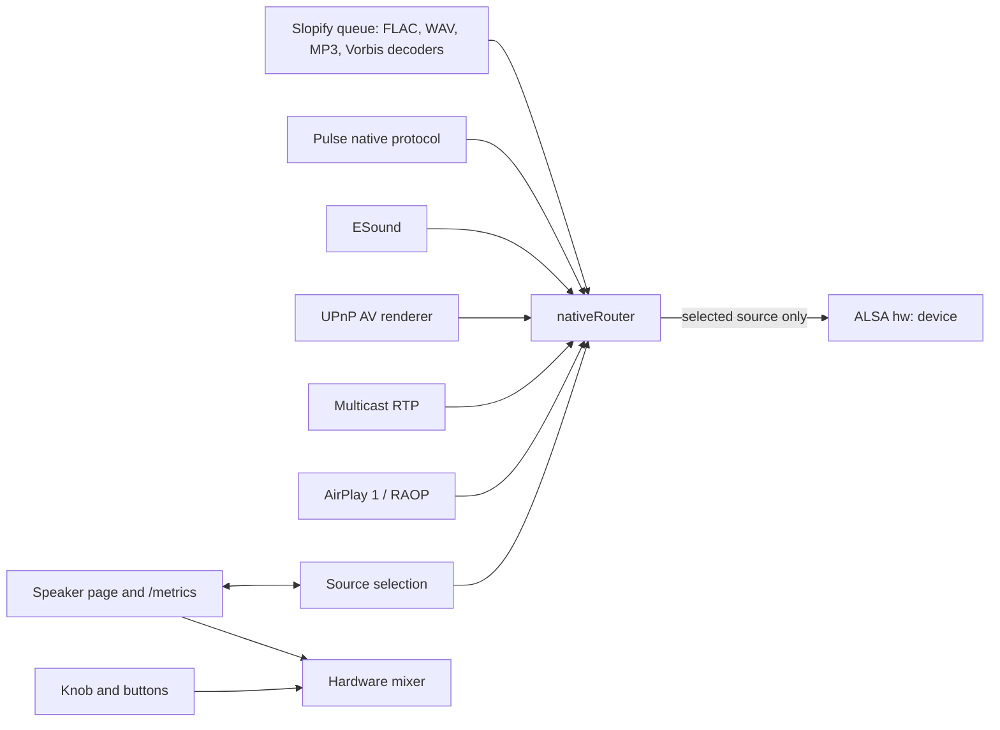

# Local network audio

How a Slopify speaker receives audio from the local network and shares one DAC between
those senders and the Slopify queue. The Go code in `player/` is the source of truth. For
installing and using a speaker, see [player/README.md](../../README.md).

## Goals

1. **Lossless, native-rate playback of Slopify originals.** Preserve the decoded sample
   rate and integer precision through to the physical output. Packing 16 or 24 bits into a
   wider word and duplicating mono are allowed. An unsupported format or rate is a visible
   error, never a silent conversion.
2. **Audio from laptops over the LAN.** Accept desktop audio, identify its sender and show
   its format. A laptop may already have mixed or resampled it, so this is not a claim of
   bit transparency for the original recording.

Raspberry Pi 3, Pi 4 and Pi 5 are first-class player targets. The local player
UI stays minimal: volume, mute and play/pause; previous/next are planned, and
selection of an existing queue is a possibility. Catalog browsing, adding tracks
and queue editing belong exclusively in the desktop/mobile browser UI and will
never be added to the local player UI.

The purpose is music: audio-video sync and gaming are not priorities. Other protocols must
not compromise the path for originals.

## Implemented

One static Go binary owns the whole path from network to ALSA `hw:` device, with no sound
server. Parts of this are new and have had little listening time, as the
[status table](../../README.md#status) records.

| Part | Source | Role |
|---|---|---|
| Source policy | `player/localsources.go` | Bounded source registry, selection, pinning, persisted settings |
| Router and receivers | `player/native_sources.go` | `nativeRouter` owns the device; LAN streams become sources |
| Pulse | `player/internal/pulse` | Playback-only native-protocol server |
| ESound | `player/internal/esound` | Playback-only server |
| UPnP | `player/internal/upnp`, `player/upnp_source.go` | Media renderer pulling FLAC, WAV/RF64 or L16/L24 |
| RTP | `player/internal/rtp` | Multicast receiver for L16 and L24 sessions announced over SAP |
| AirPlay | `player/internal/raop`, `player/raop_source.go` | RTSP negotiation, ALAC over UDP, metadata and DACP control |
| Originals | `player/native.go`, `player/internal/audiodec` | Native decoding, prefetch and gapless playback; Vorbis uses floating point |
| Output | `player/internal/alsa` | Pure-Go PCM and mixer access through kernel ioctls |
| Speaker page | `player/localui.go`, `player/ui/` | Status over SSE, selection, volume, sender setup, `/metrics` |

Earlier versions used PipeWire with WirePlumber policy, patches and a native Go client.
They were built and removed; git history has the details. The main lessons were that
isolating every program's conversion defaults is hard to verify, and that a float32 round
trip does damage full-S32 audio: an unpatched loopback test changed 92,557 of 96,000 S32
samples by up to 64 LSB, while S16 and S24 patterns were exact.

### Output and format rules

- `SLOPIFY_OUTPUT` is `alsa:hw:...` (also spelled `aplay:hw:...`) or `null`. Other ALSA
  device names are refused, so ALSA's plug layer cannot convert.
- The device is opened at exactly the requested rate and channels, trying S32LE and then
  narrower word sizes that still hold the source's bits. There is no fallback to another
  rate. An explicit `-allow-truncate` option permits a 16-bit output fallback;
  it is off by default and is not a lossless path.
- A LAN stream has its samples widened to S32 by integer operations. Pulse float32, which
  Chrome sends, is unpacked the same way, keeping every mantissa bit. Samples beyond full
  scale are cut off and counted in `slopify_audio_clipped_samples_total`.
- Nothing is resampled, mixed or scaled. Pulse rate-adjustment requests are refused.
- Clock drift is not corrected by resampling. A sustained difference can cause
  counted underflows or overflows. Multicast RTP additionally trims excess buffered
  audio at a track marker, as described below; this is not sample synchronization.

### Source slots

The registry holds Slopify plus 30 LAN slots, `lan_1` to `lan_30`. It admits the newest session per peer and keeps disconnected
peers, along with their place in the list, in `-local-state`. A Pulse sender's key hashes
its `application.process.host` (or IP address) and `application.name`, so its slot survives
an address change. The key only sorts cards and is not authentication. Different applications
on one laptop get separate slots.

### Selection

| Mode | Behaviour |
|---|---|
| Off | Pins the selected source, shown as a closed padlock. Network traffic cannot displace it. |
| Recent | The most recent source to start sounding wins. A new source must sustain sound for the Minimum sound duration (0–2000 ms, default 500), which stops short notifications taking over. A source counts as sounding at a peak of 0.001 (−60 dBFS) or above, and stops two seconds after falling below it. |
| Priority | The first sounding source in the persisted card order wins. Upward takeovers can require sustained sound for `priorityTakeoverMs` (0–10000, default 0). The selected source keeps its place through silence and gaps for `prioritySilenceMs` (0–120000, default 30000). |

- A selected stream has three seconds after playback is ready to report its first meter
  reading, and selection waits during that time. Missing meter data is unknown, not silence.
- While Priority is holding, the page shows the sounding fallback and a countdown. **Switch
  now** selects it without pinning.
- An explicitly paused Slopify queue bypasses these holds. A pin still wins.
- Unpinning in Recent mode marks the current source as latest, so peers that are already
  playing don't immediately take over.
- A switch closes the device, withdrawing whatever it still held, and the next source opens
  it at its own format. There is no crossfade.

### Interaction with the Slopify queue

A LAN source never edits the queue or reports progress for it. Everything below goes through
`/device/v1/control`, which checks the version and entry, so a stale request does nothing.

- When selection moves away from Slopify while it plays, the device sends
  `pause-if-sole-output`. The server pauses only if this device is the queue's only selected
  output, otherwise the queue carries on, paced and unheard here.
- Explicitly pinning Slopify sends `play-if-sole-output`, resuming a paused queue under the
  same condition. Automatic selection of Slopify never resumes one.
- Failed requests are not replayed, and no list of LAN sources is sent to the server.

### Volume

Volume is opt-in, and uses the hardware mixer only. Samples are never scaled. The knob, the
speaker page and the web app change the same control within the configured range. A sender's
slider maps 0–100% onto that range. Moving the hardware level moves only the slider of the
sender connected to the amp, and a sender already at that level is left alone so a drag never
fights its echo.

### Receivers

All are opt-in and need `-local-source-control`, which needs `-local-listen` and the native
engine. **None has authentication, and only AirPlay can be encrypted: they are for a trusted LAN only.**

| Protocol | Flag | Port | Limits |
|---|---|---|---|
| Pulse native | `-pulse-listen` | TCP 4713 | S16LE, S24LE, S24-32LE, S32LE or float32LE; mono or stereo; 8–384 kHz; 8 clients with 8 streams each. No recording, modules or samples. The client's cookie is read and ignored. |
| ESound | `-esound-listen` | TCP 16001 | 8 or 16-bit, mono or stereo streams only, paced by TCP backpressure |
| UPnP AV | `-upnp-listen` | TCP 49494, UDP 1900 | No eventing or playlists. Plain HTTP pull, private addresses only (checked at dial time), no redirects |
| AirPlay 1 (RAOP) | `-raop-listen`, `-raop-buffer-ms`, `-raop-key` | TCP as configured (5000 on OpenWrt), plus three UDP ports per session | ALAC (16–32-bit, mono or stereo, 8–192 kHz), UDP transport only, 8 connections. Plain or RSA-wrapped AES. Track text and DACP remote control. No FairPlay, AirPlay 2, timed playout or artwork |
| Multicast RTP | `-rtp-receive`, `-rtp-interface`, `-rtp-buffer-ms` | UDP 9875 on 224.0.0.56, then each announced group and port | IPv4, L16 or L24, 8–192 kHz, 1–8 channels, 8 sessions. Only private sources, and only packets from the address that announced the session |

**Multicast behaviour.** A card is one sender on one group. The port is excluded because
PulseAudio picks a random one each time its module loads, and the group alone is not enough
because both senders default to 224.0.0.56. Multicast has no flow control and nothing
resamples, so a stream starts at `-rtp-buffer-ms` and holds twice that. Overflow discards the
oldest audio back to the start point, and running dry rebuffers; each is an audible jump, far
apart if the clocks are close. Lost packets play as silence so the stream keeps its timing,
and late ones are dropped. Three seconds without packets ends the stream, leaving the card
remembered. Physical playback and long-run drift still need validation for each
device/sender combination.

**Receiver reporting.** Opt-in RTP senders and receivers exchange RTCP SR/RR and
SDES identity on the multicast audio port plus one. Control sockets retry outside
the audio path. The local sender UI lists up to 32 reporting receivers with IP,
name, last report, packet loss and jitter; entries expire after 90 seconds.
Reports match the current sender SSRC, keeping different senders on one group
separate. Each receiver gets its own line from Slopify, solid while reports show
recent packet reception; idle receivers have no connection line. This is not audible-playback status,
receiver authentication or cloud inventory. Clients without RTCP remain invisible.

**Multicast sender.** `-rtp-send` copies decoded Slopify audio from `nativeBackend` to a group
chosen at random at each start (`239.1-127.x.y`, avoiding addresses that share Ethernet addresses with
the link-local block) or set with `-rtp-send-group`. It
never holds up local playback: a queue up to four seconds long absorbs a device's opening burst, is paced in real
time, and discards its oldest audio when full. Each track is announced at once over SAP, with title, artist and
album in clear text, and its first packet carries the RTP marker. A receiver whose delay has drifted more than 50 ms
above target trims back at that marker, the resynchronisation point. A format change also changes the payload
type and SSRC. L32 is not a registered format. Reception requires opt-in `-rtp-receive`, and a player ignores its own sessions.
Optional `-queue-share` adds automatic same-queue following, described below.

**AirPlay behaviour.** `internal/raop` negotiates RTSP; `Stream` holds decoded audio and knows
nothing of negotiation, and packets pass a cipher before the ALAC decoder. AirPlay 2 pairing,
PTP timing and its ciphers would wrap those seams. Like multicast, nothing holds a sender back:
a stream starts at `-raop-buffer-ms`, holds twice that, discards its oldest audio when full and
realigns at a sender's first sync after starting. Out-of-order packets are reordered, a gap asks
the sender to resend once and is played as silence after 120 ms. Audio is accepted only from
the RTSP peer's address. Volume moves the hardware level of the selected sender only, -30..0 dB
across the configured range and -144 to mute. Only TCP transport is refused: PipeWire 1.6.2's
TCP framing writes the length into the audio, so UDP alone is advertised. PipeWire also fills
packets to the MTU beyond the 352 frames it announces and omits the final end tag; the decoder
accepts both. The RSA key is not in the repository. `-raop-key` loads it only if its modulus
matches the public key in every sender, so a substituted download is refused; without it the
receiver offers plain RAOP (`et=0`), which Apple devices do not use.

**AirPlay metadata and remote control.** `md=0` asks senders for track text: title, artist,
album and genre from DMAP, shown as allowlisted `media.*` fields. Artwork and progress are
ignored. A sender's `DACP-ID` and `Active-Remote` token stay in memory, never in logs, status or
state. While that sender is the selected source, hardware buttons, `/api/playback` and the
card's buttons send `playpause`, `nextitem` or `previtem` to it instead of the Slopify queue.
The `iTunes_Ctrl_` record is resolved through Avahi and used only if it names the RTSP peer's
own address; requests have no redirects or proxy and a three-second timeout. Play state is
inferred from recent sound, as DACP status is not polled, and the speaker's volume knob does not
move the sender's slider.

**Pulse behaviour to preserve.** PipeWire's tunnel steers reported latency plus its ring to
200 ms. Latency replies include actual device delay; stream indices already account
for the input queue. The player never buffers beyond what the tunnel asks, because
past that the tunnel drains its ring and sends silence, heard as steady ticks.
The LAN-source output default is 40–80 ms (Slopify originals keep 200–500 ms).
`-output-buffer-ms` overrides output capacity for all sources from 40 to 10000 ms. A/V correction remains experimental. A tunnel also answers an underflow by
rewinding and resending, heard as looping, so a live stream is never read faster than real
time, and the start threshold stays below the target minus `minReq`.

**Best-effort multicast alignment.** `-rtp-local-delay-ms` holds the transmitting
speaker's local queue audio back by an additional 200 ms by default (0–2000 ms;
zero disables). It does not enlarge ALSA buffers or delay received LAN sources.
The sender and delayed local copy use a common monotonic timeline, re-anchored
at track boundaries and after interruptions. Receivers retain their configurable
200 ms input default and track-marker correction. Device latency remains
additional; independent DAC clocks can drift between boundaries. No samples
are modified to chase synchronization. This is approximate alignment, not
scheduled playback against a synchronized clock on all speakers.

**Discovery.** The player publishes its receivers through Avahi's D-Bus API: `_pulse-sink._tcp`
as `name via PulseAudio`, IPv4-only when the receiver binds an IPv4 address, and
`_raop._tcp` as `HWADDR@name via AirPlay` with a hardware ID derived from the host
and player name. Discovery is not authentication, and multicast reflection is
not configured. These two receiver transports use unicast; RTP uses multicast.
The speaker page also gives manual tunnel commands for routed networks.

### Speaker page and metrics

`-local-listen` serves the page, `/api/*` and `/metrics` with no login. Mutations require
same-origin JSON and a custom header. Source settings carry an expected revision. The page
gives each mutation an eight-second deadline and never replays one automatically. The page shows source and output formats,
peak charts, buffers and the sender setup. Source metadata is limited to allowlisted fields
and rendered as text. Tokens, signed URLs, file paths and arbitrary application properties
are never shown. Tabs share one SSE connection through SharedWorker where
available, with direct EventSource fallback.

`/metrics` labels audio series with `stage` (download, input, output), `transport`
(https or http for the queue's originals, multicast, pulse, airplay, esound, upnp, cue)
and `source`: the server's hostname for the queue, or the sender's verified IP address
(`IP@group` for multicast), bounded by source slots,
so one family covers a glitch wherever it began: `slopify_audio_underruns_total`,
`_overflows_total`, `_errors_total`, `_buffer_ms` (input queue or device delay),
`_write_ms`, `_receive_gap_ms` (network), `_loop_ms` (scheduling), `_opens_total` and
`_rate_hertz` (a source's input rate; the device's, under the source that owns it).
The multicast copy reports as stage output, transport multicast, source the server hostname. Peaks are amplitude envelopes for the page,
not RMS, and are not exported as metrics.

### Local player discovery

The local UI publishes and browses `_slopify._tcp` using the Go D-Bus client and Avahi.
Records contain the display name, host and web port plus a random per-process ID
for self exclusion. Up to 64 resolved interface records are retained, deduplicated
by URL for sibling navigation. Typed D-Bus removal events and reconnects clear stale
entries. Valid `.local` names are preferred to private-address fallbacks. These
are untrusted navigation links, never automatic HTTP requests. No queue identity,
media URL or credential is advertised. Discovery alone does not elect a leader; optional queue deduplication below
uses the discovered peers.

### Optional local queue deduplication

`-queue-share` enables local election and multicast reuse; it is off by default.
The server provides selected devices with a persisted random queue identity and
a fresh command tag when distributing queue commands. No LAN topology, leader
or receiver state is sent to it. Each player retains its own cloud control
connection; only original fetching and decoding are deduplicated.

Players use Avahi-discovered private numeric addresses to poll bounded status
at `/api/queue-link` on the existing LAN UI port. The status contains hashed
queue/track identifiers, command identity, eligibility, RTP instance/group and
progress. It contains no signed URLs or credentials. Election prefers eligible senders needed by pinned multicast listeners, then
explicit RTP senders, then process identity as a deterministic tie-break.
A follower requires the elected peer to claim leadership and fresh matching
RTP audio before stopping its decoder. It retains logical Slopify selection and
relays matching progress/end reports with its own device credentials; thus a
follower may still fulfil the cloud primary-output role. Pauses, seeks, loss of
peer/audio or switching to another source invalidate following. Gaps during
re-election are accepted. No clock/sample synchronization is promised.

Implicit senders transmit only when another queue listener exists; explicit
senders retain independent multicast behaviour. The local UI dims an automatic
multicast input to 20%, names it on the Slopify card and draws a solid coloured
line at 20% opacity directly from that input to the amplifier. Pinning the input makes it solid and selects it directly.

Pinned Slopify multicast listeners advertise their chosen sender instance/group,
including on receiver-only devices. This demand keeps an implicit sender running
with no other automatic queue listeners; that sender retains its own decoder
instead of becoming a follower. Duplicate peer records count once, and one missed
poll does not bypass the three-second peer grace period. Internal leader changes
are silent; transition cues apply only to changes of the selected logical source.
The Slopify card summarizes Direct, Sending to N players, or Following NAME, with
fallback reasons. Idle multicast output panels are hidden unless there is an
error. Disconnected unselected sources collapse their charts and details, with an
accessible Details button. Pin labels distinguish following the queue from
staying with a particular multicast sender.

The player header's hamburger holds routing policy, sound/takeover/fallback
sliders, the transition-sound toggle and the relative LuCI “Player settings…”
link. Diagnostics remain beside their sources/output. Escape or clicking outside
closes the menu. Natural forward track completion preserves QueueCommand and
existing multicast followers; explicit commands and repeat wraps invalidate it.
Election/membership use queue identity and continuity command rather than a
transient current-track match. New followers still require matching current
track/audio; existing followers keep their route through a bounded three-second
RTP format-change gap. The physical multicast-to-output line remains through
that interval, without a duplicate Slopify-to-output line or decoder restart.

Multicast transmission and SAP advertisement require an eligible locally decoded
source to be selected. Currently only direct Slopify playback is eligible;
PulseAudio, ESound, incoming multicast, UPnP and AirPlay are not. Automatic
multicast-backed Slopify is also ineligible. Explicit sender configuration and
pinned downstream demand cannot override this source gate. Switching to an
ineligible source clears queued RTP audio, withdraws SAP, hides SDP and suppresses
sender reports; returning to eligible local playback restores advertisement.
Only Slopify and the planned Spotify backend (source ID `spotify`) are allowlisted; that
backend must still feed the sender itself. AirPlay and other LAN inputs are never
retransmitted. Source eligibility is separate from election.

Queue election prefers eligible senders required by direct multicast pins, then
explicit sender configuration, then deterministic identity. This avoids a
preferred sender competing with a source that must stay live for pinned listeners.
A fresh sibling report that it is receiving or otherwise ineligible hides its
unselected RTP card and excludes it from automatic selection. Existing pins and
remembered source order are preserved; the card returns when sending is eligible.

### Decoder builds

Native codecs have build-time exclusions: `no_flac`, `no_wav`, `no_mp3`,
`no_vorbis` and `no_alac`. Soft-float MIPS builds omit Vorbis automatically;
other control-plane floating-point operations use software emulation. FLAC,
WAV, MP3 and ALAC sample decoding is integer-only. See the
[player build options](../../README.md#decoder-build-options).

Cross-user output sharing is planned through [federation](../../../server/docs/design/federation.md).
`-queue-share` only deduplicates audio for devices already selected on the same
queue; it grants no access to another user.

### Verification

Go tests compare the FLAC, WAV, MP3, Vorbis and ALAC decoders with ffmpeg, and
`SLOPIFY_TEST_ALSA_LOOPBACK=Loopback` covers output on an idle snd-aloop card. Nothing here
proves DAC bit transparency: that needs a capture of the physical output or digital receiver.
The AirPlay receiver was checked against PipeWire 1.0.5 `module-raop-sink`, unencrypted and with
RSA, in a private PipeWire instance: a tone reached the meter with no lost frames. Apple senders
have not been tried.

## Not implemented

The following records deferred work and excluded features, not implemented capabilities.

### Deferred receivers and excluded Chromecast support

New receivers plug into the shared pieces: `liveStream` for audio and track text through
allowlisted `media.*` properties, `remoteSource` for play/pause and skipping from the speaker's
controls, the sender-volume worker for their volume scale, `cleantext` for sender names and
`advertise` for mDNS. A future Spotify backend may be retransmitted over multicast.
Spotify is not implemented; the ongoing upstream playback failure is tracked in
[librespot #1649: Audio key error](https://github.com/librespot-org/librespot/issues/1649)
(open when checked on 2026-11-08). Do not assume a usable backend from protocol support alone.

Chromecast will not be implemented: its receiver authentication requirements are
outside the project scope. It is excluded from the roadmap.

AirPlay 2 is deferred until AirPlay 1 is usable with updated macOS and iOS clients.
Its complexity is not justified before that baseline works. It would add HomeKit-style pairing, PTP timing, its own ciphers and buffered audio to the
AirPlay 1 receiver, keeping its `Stream` and decoder. File codec, AirPlay wire codec and DAC
format are separate facts, so report the negotiated mode rather than inferring it. Don't
promise 96 or 192 kHz, or that an app chooses a lossless path. The ALAC decoder has no container code; Slopify playback of ALAC files would
also need an MP4 demuxer.

### Android and Windows

Both would need a paired sender app, since neither has a suitable built-in network output:

- **Android:** [playback capture](https://developer.android.com/media/platform/av-capture)
  needs user consent per session, and only captures apps and usages that permit it. It is not
  universal system-audio casting.
- **Windows:** [WASAPI loopback](https://learn.microsoft.com/windows/win32/coreaudio/loopback-recording)
  captures an endpoint mix or a supported application. A true output device needs driver work.
  ESound through WinESD already serves Windows XP and 2000.

A paired sender should use physical enrolment, a per-client revocable credential and TLS.
Reject unpaired senders before allocating any PCM.

### Authentication

LAN authentication is deferred to later work. The LAN surface is open by design
for now, on the basis of a trusted network. Before a speaker
can sit on a less trusted one, it needs:

- Local administration: pairing during a short physical-presence window, a revocable credential
  separate from the Slopify device token, trusted HTTPS or an SSH tunnel, and exact Origin and
  CSRF checks. Don't trust forwarded identity headers or source addresses alone.
- Receivers: real Pulse cookie checks, which authenticate a group rather than a device, with
  network restrictions alongside. An IP allowlist is not identity and Pulse TCP is not encrypted.
- Metrics: a separate authorised listener.

### Smaller ideas

- Merge an application's streams per laptop into one source, and detect tunnels so a direct client gets
  real delay reports for A/V sync.
- Per-source preemption settings. A receiver can't remove a notification already mixed into a
  system stream, and the Minimum sound duration is only a timing guard. Sender-side filtering
  is the reliable answer.
- Click modes on the knob for pinning and cycling sources. The push button defaults to play/pause; `-button-action=mute` instead toggles
  hardware output mute without pausing the shared queue (requires volume control).
- Report whether a speaker is rendering Slopify to the server, so the web app doesn't show
  Playing while a LAN source holds the DAC, without sending a LAN source list.
- Test on real hardware: 44.1/48/96/192 kHz changes, long-run underruns and clock drift on
  Pi 3 and Cubietruck, and blocked-sender reconnect loops. No performance or latency figure is
  guaranteed until measured.
